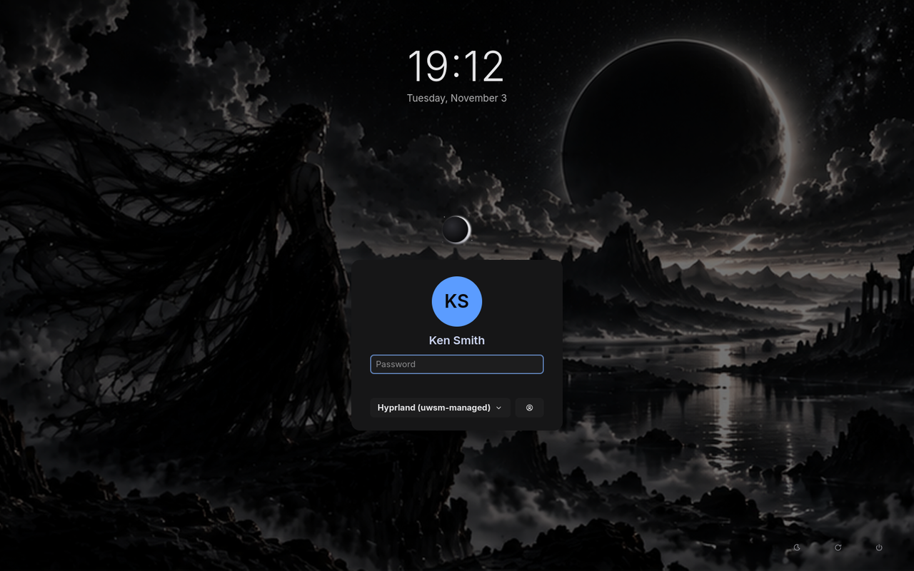

# Nyx Greeter

The NyxOS login screen: a [greetd](https://sr.ht/~kennylevinsen/greetd/) greeter in
Rust and GTK 4, running in a bare Hyprland session.



- The theme's wallpaper, darkened, on every display, with the clock; the card sits on
  the largest.
- The last user and their session are preselected; the others are one click away.
- Passwords, fingerprints and any other PAM prompts, as PAM sends them.
- Suspend, restart and shut down.
- Colours and fonts from the Nyx theme set for the system, never a user's.

## Layout

| Path | What |
| --- | --- |
| `crates/nyx-greetd` | The greetd protocol, and a fake greetd for tests and demos |
| `crates/nyx-greeter-core` | Config, state, users, sessions and the login conversation, without GTK |
| `apps/greeter` | The GTK app |
| `data/hyprland.lua` | The session greetd runs it in |
| `data/config.toml` | Every setting, documented |
| `nix/` | The NyxOS package and how to wire it up |

## Running it

On NyxOS, greetd runs it:

```sh
Hyprland --config /path/to/share/nyx-greeter/hyprland.lua
```

It reads `/etc/nyx-greeter/config.toml` and remembers the last user and session in
`/var/cache/nyx-greeter/state.toml` (`NYX_GREETER_CONFIG` and `NYX_GREETER_STATE`
move them).

To try it in a normal session, against a fake greetd where every password is `nyx`:

```sh
cargo run -p nyx-greeter -- --demo --only <output>
```

`--demo-finger` asks for a fingerprint first. `--only` keeps it to one output and off
the keyboard, so it can sit on a headless output and be captured with `grim`.

## License

MIT
